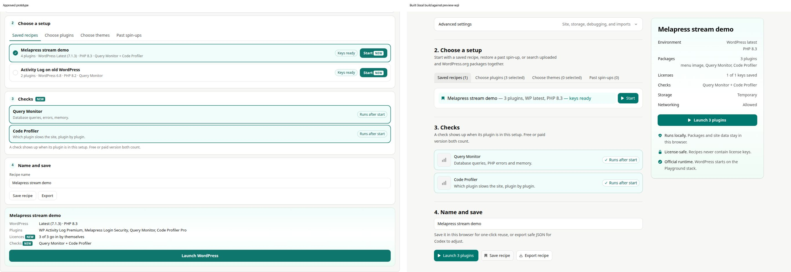
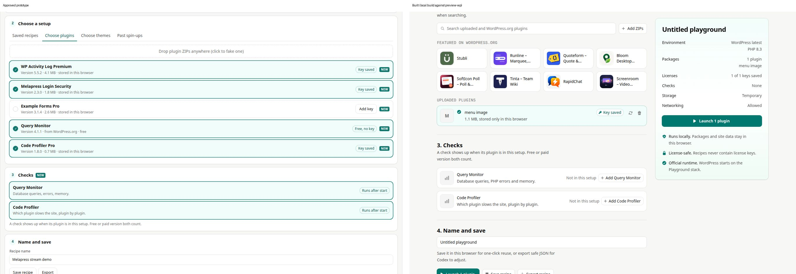
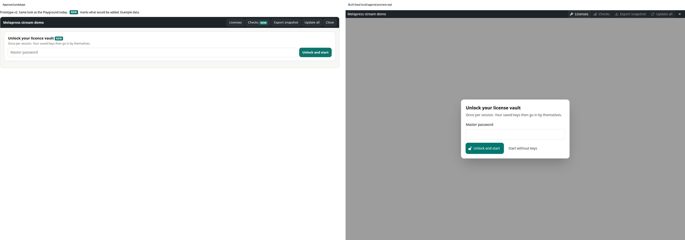
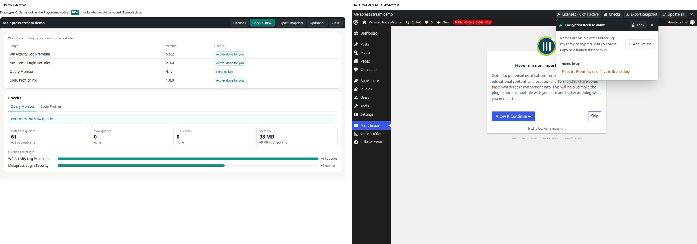
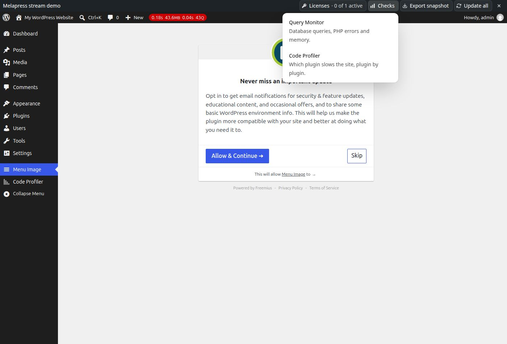
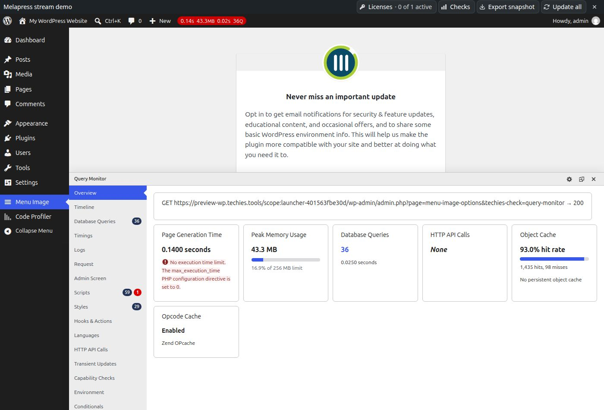
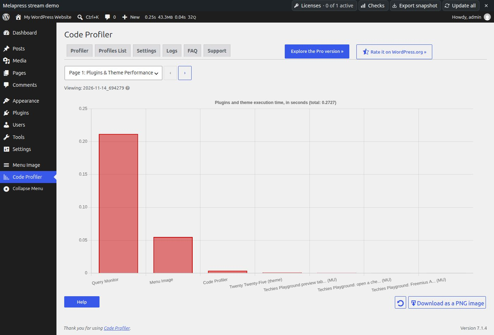

# One-click start, saved keys filled in, and Checks (TOOLS-250, Tuesday slice)

- Date: 2026-11-14
- Owner: fleet-lead builder (Claude Opus 5.5)
- Status: complete
- Disposition: kept
- Related version: 0.10.0
- Related commit/issue: TOOLS-250; builds on the Freemius licence calls ([record](2026-11-14-freemius-licence-activation.md), PR #30)

## Context

For the live stream on 17 November, Lex approved a prototype (fleet inbox, `playground-TOOLS-250-one-click-prototype-2026-11-14.html`) with three additions to today's launcher: a Start button on each saved recipe, saved license keys that go into Freemius plugins by themselves, and Checks (Query Monitor, Code Profiler). Before this change a saved recipe had to be selected and then launched, keys had to be copied from the vault into WordPress by hand, and the vault forgot its key whenever the manager closed.

While this was being built, Lex tried the preview and reported that his stored plugin ZIP was not installed at launch.

## Hypothesis and success criteria

- One click on Start launches a saved recipe with its WordPress/PHP versions and every plugin of the setup, from the browser's stored ZIPs.
- Per uploaded plugin, Choose plugins shows Key saved or Add key. One vault unlock per page session; a launch fills saved keys into Freemius-based plugins. Keys stay out of recipes, logs, URLs, files and Blueprints.
- A Checks section and a Checks button in the Playground bar, shown only when Query Monitor or Code Profiler is in the setup, with results read inside WordPress.
- Plain launches keep working.

## Options considered

- Filling keys: (a) type the key into the vendor's licence form inside WordPress, which needs a script per vendor page and leaks the key into page scripts; (b) write the key into WordPress options, which skips the vendor's activation; (c) call the plugin's own Freemius SDK (`activate_migrated_license`, public) from one PHP request whose body carries the key. Chosen: (c).
- Opening Query Monitor: it opens its panel only from its admin-bar link (no URL or hash does it; tested), so a small must-use plugin clicks that link on request.
- Persisting the unlocked key: kept in memory for the page session only, never stored.

## Implementation or prototype

- `src/lib/checks.js`, `src/lib/license-fill.js`, `src/lib/vault-session.js`; `readLicenseKeysForPackages` in `src/lib/license-vault.js`; UI in `src/App.jsx` (Start, Add key, Key saved, Checks section and menu, Licenses summary, unlock prompt over the frame, summary rows).
- `launch()` takes the recipe to launch, so Start launches the chosen recipe without waiting for state to settle.
- Stored-ZIP failure: reproduced on preview-play.techies.tools (dev before this change) in Firefox with **Save playground in browser** on: the Playground frame stayed blank for 5 minutes and nothing was installed. Cause: `navigator.storage.persist()` stays pending in Firefox until the visitor answers its permission prompt (10-second probe: Firefox still pending, Chromium resolved `false`), and the launch awaited it before starting Playground. The launch now asks without waiting (`requestPersistentStorage`). Chromium and temporary sites were not affected, which matches a report that depends on the browser and the storage setting.

## Code Profiler spike

Code Profiler profiles by requesting the site from itself. In browser Playground (preview-wp.techies.tools, WordPress 7.1.4, PHP 8.3, Chromium, Code Profiler 1.9.6 free), pressing Start profiling on `admin.php?page=code-profiler` produced its "Plugins and theme execution time" chart for every active plugin. Spike passed; Checks ship with both tools. Code Profiler Pro was not available to test: its page slug `code-profiler-pro` is assumed.

## Tests and evidence

| Environment | Procedure/command | Expected | Actual | Evidence |
| --- | --- | --- | --- | --- |
| Node 24, worktree | `npm test` (final run before the PR update, five runs in a row) | all pass | 163 tests, 0 failures each time | local run |
| New tests before the change | `node --test` on `checks`, `license-fill`, `vault-session`, `license-vault`, `playground-persistence` tests | fail first | failed (module or export missing), then passed | local run |
| Chromium, local build against preview-wp | Spike: launch Query Monitor + Code Profiler + Menu Image, run Code Profiler | profile result | chart shown | screenshot in PR |
| Chromium, local build | Fake 32-character key for Menu Image (free, ships the Freemius SDK 2.12.1) run through the fill code | Freemius answers | `Invalid license key.` (a short key gave `License key too short`) | script output |
| Chromium, local build | Full flow: plain launch, upload ZIP, Add key (new vault), add both checks, save recipe, reload, Start, unlock, Licenses, Checks menu, Query Monitor, Code Profiler | as in the testing matrix | Licenses `· 0 of 1 active`; manager `Filled in. Freemius said: Invalid license key.`; QM panel opened; Code Profiler page without QM panel, profile chart; no page errors | screenshots in PR |
| Chromium, 320 px | Add key form, saved recipe row, Checks section | usable, no new overflow | usable; the page-level overflow at 320 px and the Advanced settings label overlap were already present | screenshots |
| Chromium, 320 px (after review round 2) | Playground bar with Checks and a fill, unlock prompt | Close on screen | name truncated, icon-only buttons with wider gaps, `0/1`, Close visible; the prompt shows both buttons | screenshots |
| Chromium, 390 px (after review round 1) | Playground bar with Checks and a fill, unlock prompt | Close stays on screen | icon-only bar buttons, `0/1` fill count, Close visible; prompt shows Unlock and start and Start without keys | screenshots |
| Firefox, preview-play (dev before this change) | Upload ZIP, browser storage on, Launch | WordPress with plugin | frame blank after 5 min | script output |
| Firefox, local build with the fix | Same, then reload and launch again | plugin installed both times | `menu-image:active` both times (one earlier run timed out on the second launch; the rerun passed) | script output |
| Firefox, local build | Full flow | as Chromium | everything as in Chromium except the fill: Freemius answered `ApiBlocked` (its SDK got a Freemius web page back). Probe: a proxied POST to `api.freemius.com` echoes `uid` and `license_key` in Chromium but only the query string in Firefox, so Firefox drops the request body when Playground retries through the CORS proxy. This also blocks Freemius activation typed into WordPress in Firefox; it is outside this change. The long refusal is now cut to 200 characters of plain text. | script output |
| Chromium, 320 px (after the GPT second look) | Open Checks with Query Monitor and Code Profiler in the setup, choose Query Monitor | menu inside the screen, focus back on Checks | menu at x 8, width 304; focus on Checks | screenshot |
| Chromium, `npm run dev` (StrictMode on), after the PR review | Add key with a new vault; reload, launch, unlock from the prompt | key saved; prompt closes and the launch continues | both as expected (before the fix both stayed busy forever in dev builds) | script output |
| Chromium, local build (after the second GPT look) | Escape on the unlock prompt; choose Query Monitor twice | prompt closes the launch; panel stays open | prompt gone and shell closed; `qm-admin-panel` = `overview` after both opens | script output |
| Chromium, 320 px (after the third second look) | Bar button sizes; Tab inside the Checks menu | 36 px buttons with 46 px tap areas, Close on screen; Tab closes the menu and moves on | Licenses, Checks, Export snapshot, Update all and Close each 36 px, Close ends at 312 px; after Tab the menu is gone and focus is on Export snapshot | script output |
| Chromium, 320 px (after the PR review of the prompt) | Open Licenses over the unlock prompt and press Escape; then Escape in the prompt; measure the bar | Escape closes only the manager; Escape in the prompt closes the launch; Close fits the bar | manager closed, prompt still open; prompt Escape closed the shell; bar 32 px, Close 36 x 28 px from 2 to 30 px | script output |
| Chromium, 320 px, touch (after the last second look) | Open Checks, click inside WordPress; hit-test 6 px below Checks | menu closes; the tap reaches Checks, not the frame | menu closed; hit test returned Checks | script output |
| Chromium, 320 px | Saved recipe with an 80-character name, with and without spaces | Start never squeezes the name | the name wraps over the full row (an unbroken name breaks inside the row) and Start moves below it | screenshot |
| Deployed preview | Proof run after merge | see PR | recorded in the PR and the lead's report | pending at time of writing |

## Result

All three Tuesday items work in a local build against the preview Playground host, and the Firefox stall that kept stored ZIPs from installing is fixed.

## Disposition and rationale

Kept. It is the approved Tuesday slice.

## Documentation impact

`CONTEXT.md` (invariant 9, Check term, version), `docs/rebuild-spec.md`, `docs/architecture.md`, `docs/data-contracts.md`, `docs/testing.md`, changelog 0.10.0 in `src/App.jsx`, `package.json` and `package-lock.json`.

## Follow-ups and open questions

- After Tuesday (not in this change): our own results panel for Checks, an update-waiting status per plugin, automatic keys for other vendors.
- Code Profiler Pro's admin page slug is unverified.
- Firefox: Playground drops the POST body when it retries a Freemius API call through the CORS proxy, so Freemius activation (filled in or typed) fails there. Needs its own fix in the Freemius must-use plugin or the Playground build.
- A real (not fake) Freemius key through Start is Lex's to try; PR #30 already showed a real WP Activity Log key activating.

## Screenshots

Approved prototype next to the built launcher (local build against preview-wp, fake data and a fake key):

