# Checks panel: an overview that explains the scores, checks on the open page, what to fix first

- Date: 2026-11-21
- Owner: fleet builder (Claude Opus 5.5)
- Status: complete
- Disposition: kept
- Related version: 0.12.0
- Related commit/issue: TOOLS-388 (with TOOLS-398)

## Context

The Checks panel from 0.11.0 measured one page after launch and showed a verdict, four number tiles and a row per check, with passed checks folded into one line. Three things were missing:

- It did not say what a score meant or where its limits were.
- It checked only the page that was open when it ran. Going to another page inside WordPress changed nothing until you pressed Run again, and the panel did not say which page it had checked.
- Every number was the measure plugin's own count, even with Query Monitor active on the same page.

TOOLS-398 added four problems at 320 px with 200% text:

- The Checks title had no width left: it was 0 px wide, hidden behind Run again.
- Keep open and Discard and close had 56 px tall tap areas at that size, but no tap area at normal text size beyond the button itself.
- The start page scrolled 4 px sideways at 320 px.
- Close had to stay on screen.

Lex approved sketch round 2 on 2026-11-21. Its rules were:

- An overview of the 8 checks; a row opens one check; All checks goes back.
- The words are Passed, Warning and Improve. Good, Medium and Bad appear only in the i table.
- The i shows the real limits and a More information link to the check score article.
- Numbers roll, with no Count up switch.
- When the page changes, the open check stays open and refreshes.
- Checks run on every page, even with the panel closed, and keep the bar button up to date.
- No previous or next arrows. The panel shows which page was checked. The spinner waits before it shows.
- The panel uses real Query Monitor and Code Profiler data, says plainly when one cannot give a number, and keeps the existing limits.
- Reduced motion is respected.

## Hypothesis and success criteria

1. The i shows the limits of every check in the setup and a More information link.
2. The checks run on the open page, on every page change, also with the panel closed, and say which page they checked.
3. The overview and one-check view replace "passed folded, needs-fixing open".
4. At 320 px with 200% text:
   - Close is on screen.
   - The title is not covered.
   - Keep open and Discard and close have tap areas of at least 44 px.
   - Nothing scrolls sideways at 320 px.

## Options considered

- **Keep the tiles and add an i.** Small, but it would not answer which page was checked or what to fix first, and the sketch round replaced it.
- **Previous and next arrows between checks.** Rejected in the sketch round: the overview is one tap away and arrows crowd the header at 320 px.
- **Watch the page by polling the frame's address.** Rejected. The Playground client already reports navigation (`client.onNavigation`), which fires on the Playground's address messages and on the frame's load, and only when the path changes.
- **Overview, one check, and the client's navigation events (chosen).**

## Implementation or prototype

### src/lib/checks.js

- `STATUS_LABEL` holds the words Passed, Warning and Improve.
- `LIMIT_ROWS` is built from `CHECK_LIMITS`, so the i table and the judging always agree.
- `CHECKS_ARTICLE_URL` links the article.
- `checksByStatus` sorts what to improve first.
- `checksVerdict` and `checksAnnouncement` now name the page.
- `createCheckQueue` holds the page queue (see Run on the open page below).
- `checkedPagePath` drops `techies-check` and `techies-measure`, so opening a check in its tool does not count as a new page.

The measure must-use plugin reads Query Monitor's own collectors when Query Monitor is active: overview, db_queries, php_errors and http. Its JSON gains `source`, `qmVersion` and `repeated`, the three queries repeated most with the function that ran them, never their SQL ([data contracts](../data-contracts.md#checks-measurement)).

Code Profiler only profiles from its own screen, so it cannot give a number for the page that is open. The slowest-plugin check says so: "Timed by the Playground as each plugin loaded. Code Profiler shows the full profile."

### src/ChecksPanel.jsx

The panel has two views in one frame, the overview and one check, which slides in from the right.

- **Overview:** the page line, the verdict box with its i (a non-modal dialog with Good, Medium and Bad columns and More information), and one row per check.
- **One check:** rolling digits, the limits strip with the current level marked, where the number came from, what it found, and Open in.
- **Header:** the title wraps above Run again and Close when the row is narrow.
- **Escape:** closes the i, then the open check, then the panel.
- **Bar button:** the spinner waits 200 ms before it shows.
- **Reuse:** the existing bar button, tap target, Spinner, heroicons and Tailwind tokens. No toasts and no new dependency.

### src/styles.css

Adds `.checks-views`, `.checks-view`, `.checks-info`, `.checks-digit`, `.checks-strip` and `.checks-delay-in` / `.checks-delay-out`. Every one of them has a reduced-motion path, and only transform and opacity animate.

### src/App.jsx: run on the open page

`watchPages` subscribes to `client.onNavigation` once per launch. The callback is guarded so only the current site's events count, because the client has no unsubscribe. A run starts 400 ms after the path settles, if the licence gate is ready or a run already happened on this site. `runChecks` goes through the queue:

- A page opened during a run is checked next, and only the latest page waits.
- Going back to the page being checked drops the page that waited.
- A result for a page that was overtaken is not shown.
- Run again always runs.

### src/App.jsx: TOOLS-398 fixes

- Keep open and Discard and close each get a centred tap span of at least 2.75 rem.
- The launcher form's grid column is `grid-cols-1` (`minmax(0, 1fr)`). The setup tabs scroll on their own, but they made a plain `auto` column 304 px wide inside the 280 px form, 4 px past a 320 px page.

### Review round 1 changes

- `watchCheckPages` (src/lib/checks.js) owns the page watcher: it waits 400 ms for the page to settle and skips any address with `techies-check`, so Open in Code Profiler, whose screen keeps the parameter in its address, is not checked as a new page.
- The PHP errors number is the total; the kinds (`1 warning, 2 notices`) are in the details. A long value could push the panel sideways.
- A run on a page change keeps the last result for its first 0.6 s, so most runs (about 0.3 s) do not blink the bar and the panel.
- Screen readers hear no start for a run on a page change, and its result only when the panel is open or the verdict changed (`checksQuiet`). Run again still announces both.
- A failed run with a check open goes back to the overview, and moves focus to the row only if focus was inside the check.
- A number that stays on screen rolls from its old value; only a number that just appeared rolls up from 0.
- The i closes when you click inside WordPress, cut titles and paths show in full on hover, and the medium PHP errors limit reads `notices, deprecations`.

## Tests and evidence

Before: https://preview-play.techies.tools/ (dev at 9122075). After: a local build of this branch (`VITE_PLAYGROUND_ORIGIN=https://preview-wp.techies.tools npx vite build`, served by `vite preview`). Both were driven by Playwright (Chromium) with Query Monitor and Code Profiler from WordPress.org, a temporary site, networking on, and Plugins as the landing page. The setup asked for WordPress `latest` and PHP 8.3 (the WordPress release number was not recorded). "200% text" is `html { font-size: 200% }`. The script did not record browser console or network errors, so this record makes no claim about them.

The screenshots were taken before review round 1. The round 1 changes (below) touch behaviour and text, not layout, except that the PHP errors number is now a single total, which is shorter than before; every screenshot here shows 0 errors, so it looks the same.

The app has no dark mode (no dark styles or tokens anywhere), so there are no dark screenshots; light is the only theme.

| Environment | Procedure/command | Expected | Actual | Evidence |
| --- | --- | --- | --- | --- |
| Node 24, PHP 8.3 wasm | `npm test` | All pass | 316 of 316 pass (309 before review round 1) | New tests in `checks.test.js`, `checks-php.test.js` and `checks-panel.test.js`, plus a changed `bar-compact-labels.test.js`. Before the change, 11 of the library and PHP tests failed, 5 queue tests failed and 12 panel tests failed. The 320 px column test and the i-placement test each failed before their one-line fix |
| Chromium, after, 1280 px | Launch, wait for the first result, open each of the 8 checks | Each number with its source | "Checks on Plugins: All 8 checks passed." Query Monitor 4.1.1: PHP errors 0, Slow queries 0, Calls to other sites 0 failed, Duplicate queries 0, Database queries 30 ("30 queries, 0.038 s together."), Memory 40 MB ("16% of the site's 256 MB limit."), Page time 0.32 s, each "From Query Monitor 4.1.1 on this page." Slowest plugin 0.01 s, "Query Monitor took the longest to load.", "Timed by the Playground as each plugin loaded. Code Profiler shows the full profile." | 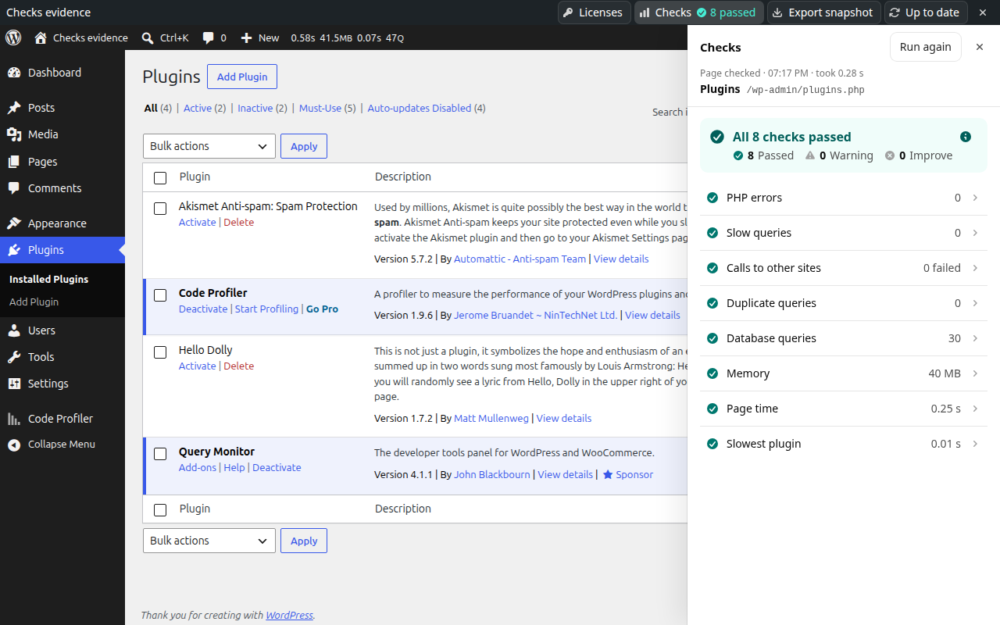 |
| Chromium, after, 1280 px | Press the i, read the link, press Escape | Limits table and the article link; Escape closes it | The table shows the limits from `CHECK_LIMITS`; the link is `https://techies.review/articles/techies-playground-check-score/`; after Escape the i is closed | 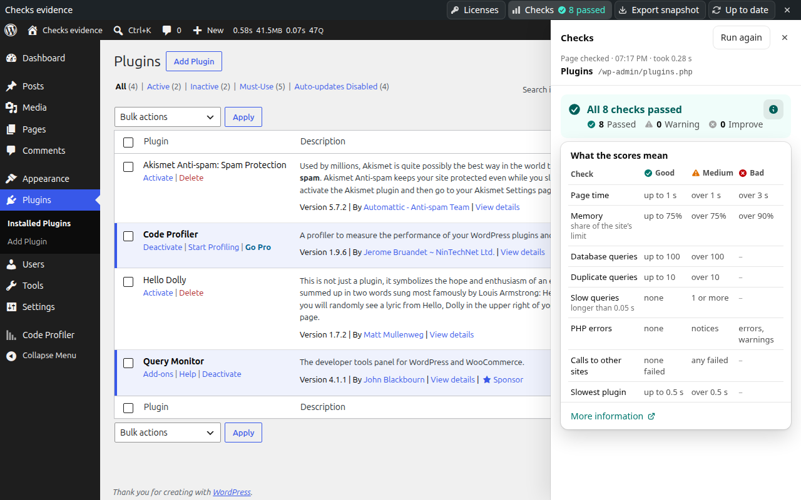 |
| Chromium, after, 1280 px | Open PHP errors, then go to the Dashboard inside WordPress | The check stays open and refreshes for the new page | "Checks on Dashboard: All 8 checks passed."; PHP errors still open; the page line reads "Page checked · 07:16 PM · took 0.33 s Dashboard /wp-admin/index.php" | 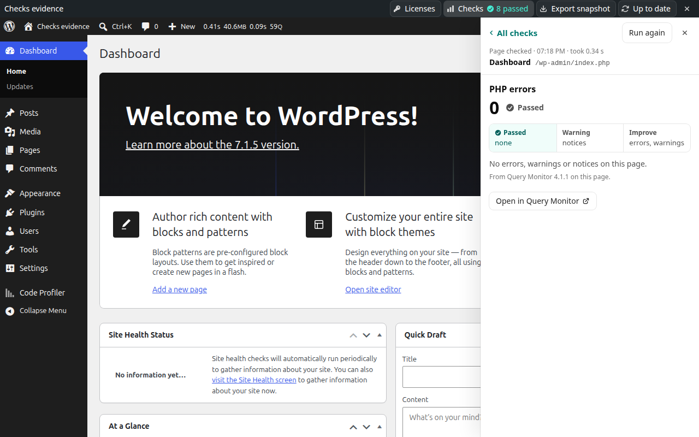 |
| Chromium, after, 1280 px | Close the panel, go to General Settings | The page is checked and the bar follows | "Checks on General Settings: All 8 checks passed." | 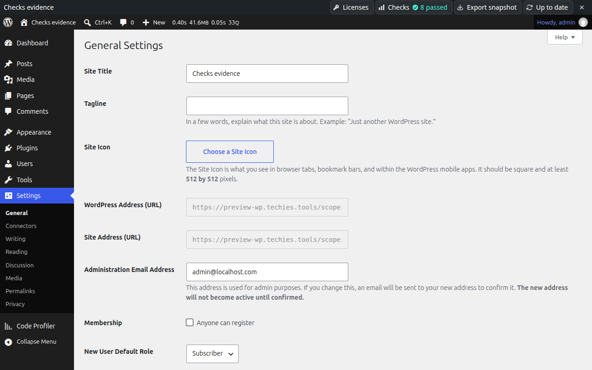 |
| Chromium, before and after, 390 px | Open the panel | Close on screen, no sideways scroll | Page 390 wide in both; after: Close at 348 to 380 px, the title at 16 to 242 px, Run again at 250 to 340 px | 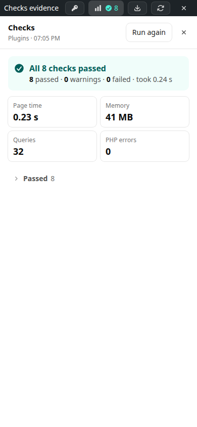 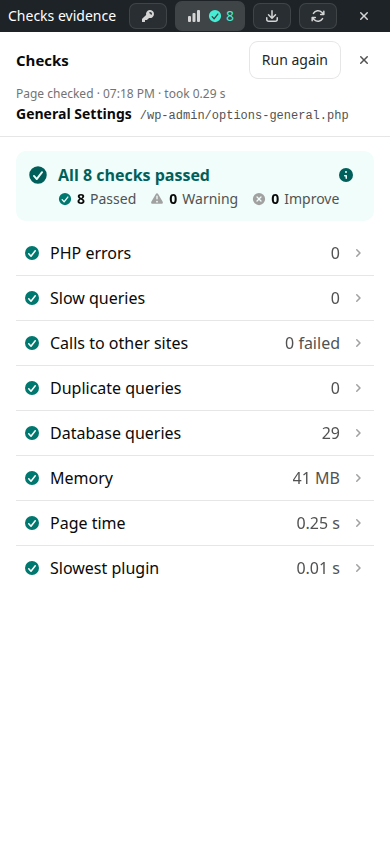 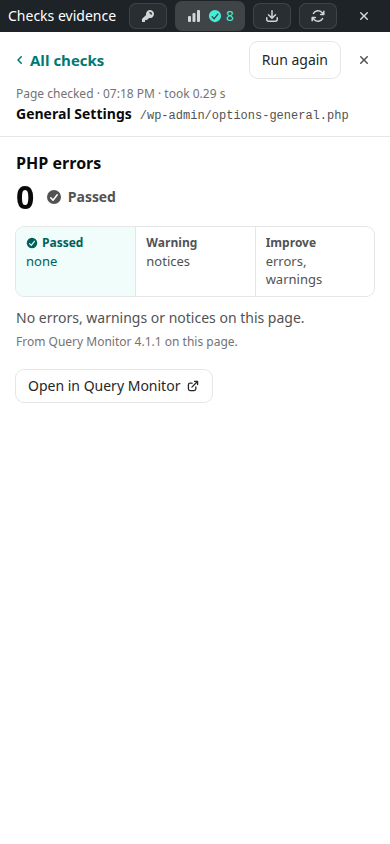 |
| Chromium, before and after, 320 px, 200% text | Open the panel, then one check | Title not covered, Close on screen, nothing spills inside the panel | Before: the title was 0 px wide (32 to 32 px), hidden behind Run again; Close at 244 to 300 px. After: the title takes its own row (32 to 300 px), Run again and Close below it, Close at 236 to 300 px, the i on its own line under the headline; no element spills out of either view | 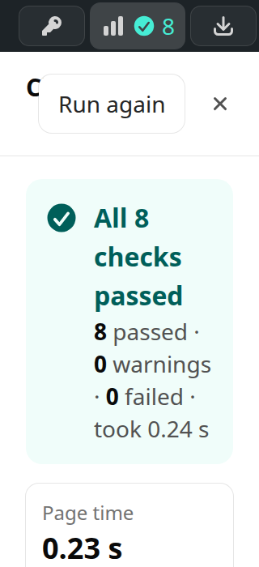 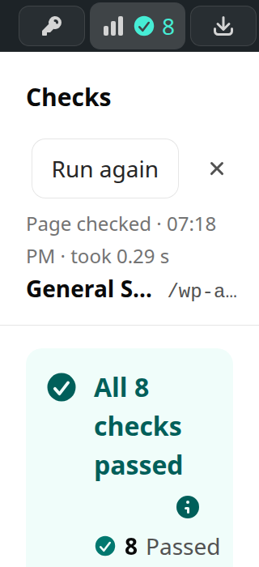 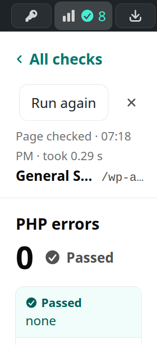 |
| Chromium, before and after, 320 px, 200% text | Press Close Playground | Keep open and Discard and close tap areas at least 44 px | Before: 173 × 56 and 262 × 56. After: 173 × 88 and 262 × 88 (the span is at least 2.75 rem, so at least 44 px at normal text) | 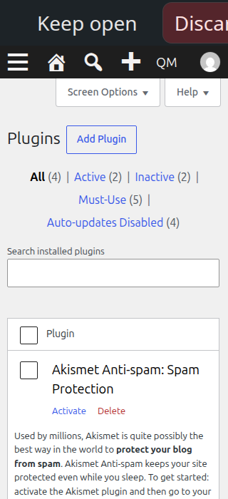 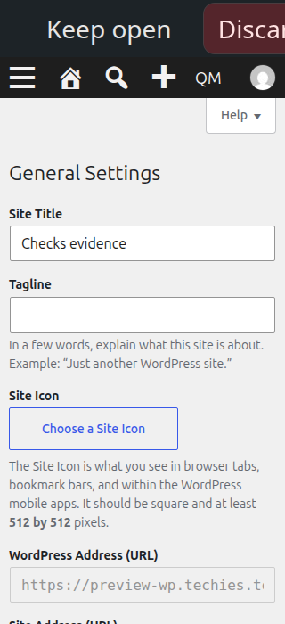 |
| Chromium, before and after, 320 px, 100% text | Launch with the panel open, then measure the page's scroll width | 320 | Before: 324 (the launcher's setup tabs widened the form's column to 304 px). After: 320 | Measured with Playwright |

## Result

- The panel explains its scores, follows the open page and says which one it checked, and puts what to improve first.
- Seven of the eight checks read Query Monitor's own numbers when it is active. The panel says when Query Monitor did not report, and that the plugin load times are the Playground's, because Code Profiler cannot profile the open page.
- At 320 px with 200% text, the title, Close, the i and the confirmation buttons all fit.
- Unexpected finding: the 4 px sideways scroll at 320 px came from the setup tabs in the launcher, not from the Playground bar.

## Disposition and rationale

Kept. It matches the approved sketch round 2 and closes TOOLS-398.

## Documentation impact

- [rebuild spec](../rebuild-spec.md): the bar's Checks button, the Checks panel and Escape.
- [data contracts](../data-contracts.md#checks-measurement): `source`, `qmVersion` and `repeated`.
- [architecture](../architecture.md): ChecksPanel and styles.
- [testing](../testing.md): the test files and a manual row.
- Version and changelog: `CHANGELOG_ENTRIES` 0.12.0, `package.json`, `package-lock.json`, `CONTEXT.md`.

## Follow-ups and open questions

- At 200% text, `body { min-width: 20rem }` makes the page 640 px wide on a 320 px screen (the fixed Playground covers it). This was there before this change. It is outside this card, so it was left as it is.
- The check score article itself is a separate sub-task of TOOLS-388 and is not part of this change.
