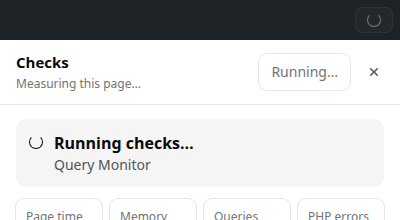
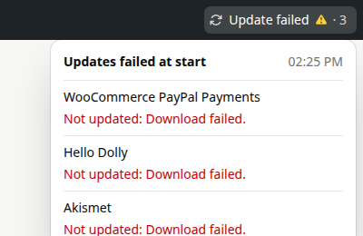

# Playground 0.11.1: the note heading after every update failed, Checks numbers at large text, a still spinner, Close at 320 px

- Date: 2026-11-21
- Owner: fleet builder (Claude Opus 5.5)
- Status: complete
- Disposition: kept
- Related version: 0.11.1 (0.11.0 shipped to `main` with PR #53, merged 2026-11-21 13:01 UTC)
- Related commit/issue: TOOLS-396 and TOOLS-392; supersedes the 320 px follow-up in [Theme updates check PHP and WordPress versions; a failed or blocked update keeps its icon](2026-11-21-theme-version-check-and-failed-updates-icon.md)

## Context

Four small defects were left after 0.11.0:

- When the update step ran and every update failed, the Updates note heading still said **Updated at start** (`src/UpdatesControl.jsx`), while the button and its tooltip already said the update failed.
- In the Checks panel, the four numbers sat in four columns until the window was narrower than 399 px. At 640 px with the browser text at 200%, a memory value of `256 MB` ran 17.3 px out of its tile into the next one (`1024 MB` 37.9 px).
- With reduce motion on, the updates and checks spinner kept turning, only slower (`spin 2.4s`).
- TOOLS-392: on a full bar at 320 px (`· 10 of 12 active`, `12 warnings`, an update result), Close's right edge was at 335.3 to 363.3 px, so up to about 43 px of it was off screen. The previous record left this as Lex chose on 2026-11-21; TOOLS-392 asks for Close to be fully visible and tappable.

## Hypothesis and success criteria

- The note heading says **Updates failed at start** when the step ran and every update failed; every other state keeps its heading.
- At 640 px with 200% text, no Checks number leaves its tile; with normal text from 400 px up, the four numbers stay in one row.
- With reduce motion on, the spinner does not animate; without it, it still turns.
- From 320 px to just below 384 px, on a normal and a full bar in every update state (including two-digit update counts), Close is fully inside the bar, the bar stays on one line, a tap at Close's centre reaches Close, no two buttons overlap, and every button's tap area is at least 44 × 56 px with no two tap areas overlapping (the project's 44 px touch size). Nothing changes from 384 px up.

## Options considered

- **Leave unchanged.** Each defect is visible to a user and small to fix.
- **Close at 320 px: hide another button's label or move Close into a menu.** The labels are already icon-only up to 767 px; hiding a button would remove a feature from phones. Tightening the gap and padding below 384 px fits Close with no feature removed.
- **Close at 320 px: a pixel `max-[384px]` breakpoint.** The bar's tests require each pixel breakpoint to come in a hide/show pair; a theme breakpoint (`xs`, 24rem, like `sm` and `md`) is the project's way to add a named width.
- **Close at 320 px: the breakpoint at 360 px (22.5rem).** The first version used it. Review asked for two-digit update counts: with 12 updates and 2 failures on a full bar, Close's edge was at 363.3 px at 360 px (3.3 px off screen, the same on `dev`). At 24rem (384 px) the tighter bar covers that case; from 384 px up the normal bar fits every measured case.
- **Checks numbers: a smaller font or a lower pixel breakpoint.** A pixel breakpoint cannot see the text size; a container query in rem (`@max-[25rem]`) switches by the panel's width measured in the current text size, so larger text switches to two columns before a number spills.
- **Spinner: keep a slower turn.** A turning spinner is still motion. What is left shows the work is in progress: in the Checks panel the words `Running checks…`; on the bar the Updates button stays disabled with the update icon swapped for the still ring, and from 768 px up the label `Updating…`; the Checks bar button swaps its chart icon for the still ring (below 1041 px its `running…` is for screen readers only).

## Implementation or prototype

- `src/lib/plugin-updates.js`: `updatesOnlyFailed(updates)` is true when the step ran, nothing was updated and something failed (the button's **Update failed** state). `updatesNoteHeading(updates)` returns **Updates at start** before the step finishes (also when networking is blocked or the step failed), **Updates failed at start** when only failures came back, and **Updated at start** otherwise. `src/UpdatesControl.jsx` uses `updatesOnlyFailed` for its tooltip and icon and renders `updatesNoteHeading` in the note's heading, so the rule lives in one place.
- `src/UpdatesControl.jsx`: the shared `Spinner` uses `motion-reduce:animate-none`.
- `src/ChecksPanel.jsx`: the panel is a size container (`@container`) and the tiles use `@max-[25rem]:grid-cols-2` in place of `max-[399px]:grid-cols-2`. The panel is `min(25rem, 100%)` wide, so with normal text this switches below 400 px as before (399 px now has two columns, one pixel earlier).
- `src/styles.css`: a theme breakpoint `--breakpoint-xs: 24rem` (384 px).
- `src/App.jsx` and `src/UpdatesControl.jsx`: below `xs` the bar's gap is 4 px (`max-xs:gap-1`, 10 px above). Licenses, Export snapshot and the shared bar button class (Checks, Updates) are at least 40 px wide with their content centred, 6 px side padding and a 4 px inner gap (`max-xs:min-w-10 max-xs:justify-center max-xs:gap-1 max-xs:px-1.5`); Close, which holds only its icon, has 12 px side padding (`max-xs:px-3`), so it is 40 px wide. Each phone tap area is the button plus that 4 px gap (`max-xs:w-[calc(100%+0.25rem)]`), so every tap area is at least 44 × 56 px and neighbouring tap areas meet without overlapping. Close is 40 × 28 px with a 44 × 56 px tap area below 384 px.
- `src/App.jsx`: the 0.11.1 changelog entry; `package.json` and `package-lock.json` at 0.11.1.

## Tests and evidence

| Environment | Procedure/command | Expected | Actual | Evidence |
| --- | --- | --- | --- | --- |
| Node 24, before the fix (9b98dcf, tests only on `dev` 4a346b2) | `node --test --test-reporter=spec src/lib/plugin-updates.test.js src/updates-control.test.js src/bar-compact-labels.test.js` | The five new tests fail | 23 tests: 18 passed, 5 failed (note heading helper, heading in the note, still spinner, tighter bar below the breakpoint, Checks tiles by panel width) | The three test files |
| Node 24, the breakpoint test after review | `bar-compact-labels.test.js` expecting `--breakpoint-xs: 24rem;`, run against the 22.5rem CSS | Fails | Failed, then passed with 24rem | `src/bar-compact-labels.test.js` |
| Node 24, the tap-area test after the second look | `node --test src/bar-compact-labels.test.js` with the test asking for `max-xs:min-w-10 max-xs:justify-center max-xs:gap-1 max-xs:px-1.5` on Licenses, Export snapshot and the shared bar button class and `max-xs:px-3` on Close, run against the `max-xs:px-2` classes | Fails | 5 tests: 4 passed, 1 failed (the bar below 384 px); after the class change 5 passed | `src/bar-compact-labels.test.js` |
| Node 24, after the fix | The same three files; then `npm test`; then `scripts/agents/kit unit --affected` | All pass | 24 passed, 0 failed (with the new `updatesOnlyFailed` test); `npm test` 286 passed, 0 failed; `RESULT: ok unit` | Same files |
| Headless Chrome (playwright-core with Chrome), `dev` 4a346b2 → this branch | A throwaway script renders a copy of the App bar with the real `UpdatesControl` and `ChecksButton`, the Updates note, the Checks panel and the spinner to static markup with each build's CSS, and measures them in the page: six update states (networking blocked, step failed, one update and two failures, every update failed, a long name, 12 updates and 2 failures) on a normal and a full bar at 320, 340, 360, 375, 383, 384, 390, 640, 641, 767, 768, 1040, 1041 and 1280 px | Close inside the bar below 384 px with every tap area at least 44 px; no change from 384 px up | Full bar at 320 px, Close's right edge: networking blocked and step failed 341.3 → 312.0, one update and two failures and every update failed 355.3 → 312.0, long name 335.3 → 312.0, 12 updates and 2 failures 363.3 → 312.0 (the bar's inner edge is 312); the page width 346/360/340/368 → 320. At 340 px the same cases 341.3/355.3/335.3/363.3 → 332.0. At 360 px, 12 updates and 2 failures 363.3 → 352.0. All 72 renders below 384 px are one line, a tap at Close's centre reaches Close, no two buttons overlap, the narrowest tap area is 44 × 56 px (Close 40 × 28 px), and no two tap areas overlap. From 384 px up all 108 renders are identical before and after |   |
| Same script | The Checks panel after a run at 640 px with `html { font-size: 200% }`, and at 1280 px 200%, 640/400/399/320 px 100%, 320 px 200%, each with values the app shows (`1.24 s`, `256 MB`, `142`, `12`; memory is rounded to whole megabytes) and with wide values (`12.3 s`, `1024 MB`, `1234`, `123`); columns counted and each number's overflow past its tile measured | No number outside its tile; four columns at 400 px and up with normal text | 640 px 200%: 4 columns with `256 MB` 17.3 px outside → 2 columns, 0 px outside; wide values 4 columns with `1024 MB` 37.9 px outside → 2 columns, 0 px outside. 1280 px 100% and 200%, 640 and 400 px 100%: 4 columns, 0 outside, before and after. 399 px 100%: 4 → 2 columns. 320 px: 2 columns, 0 outside, before and after |   |
| Same script, Chrome with reduced motion emulated | The bar's Updates spinner and the panel's `Running checks…` spinner; computed `animation` | No animation with reduce motion; turning without | Reduce: `spin 2.4s` → `none`. No preference: `spin 1s` before and after |  |
| Same script | The Updates note heading for each of the six states | Every update failed says it failed; the others unchanged | Every update failed: `Updated at start` → `Updates failed at start`. Networking blocked and step failed: `Updates at start`; the rest: `Updated at start` (unchanged) |  |

### Review round 1 (`kit review`, Claude Opus 5.5)

- Fixed: the "only failed" rule was written twice; it is now `updatesOnlyFailed` in `plugin-updates.js`, with a test.
- Fixed: this record said the bar's `Updating…` label shows the work in progress; on narrow windows that label is for screen readers, so the record now names the cues that remain.
- Fixed: two-digit update counts were not measured; measuring them found Close 3.3 px off screen at 360 px, which moved the breakpoint from 22.5rem to 24rem.
- Fixed: the Checks tiles are now also measured with wide values.
- Fixed nits: a stray "always" in the docs; the record's file name; the larger-text limit is now stated in the rebuild spec.
- Declined: "0.11.1 on top of an unreleased 0.11.0". 0.11.0 shipped with PR #53 (merged 2026-11-21 13:01 UTC) and is on `main`.
- Declined: a test that compiles the Tailwind classes. The project's tests read the source; the browser measurement above runs on the built CSS and shows the classes apply.
- Declined: the tests matching class order. They follow the style of the rest of `bar-compact-labels.test.js`.

### Review round 2 (`kit review`, Claude Opus 5.5)

- Fixed: `docs/testing.md` now names the "only failed" test.
- Fixed: the Checks example used `24.5 MB`, which the app never shows; the measurement now uses `256 MB` and `1024 MB` on both builds.
- Fixed nit: the record said Close at 313.3 px used the bar's padding; after the second look below Close ends at 312.0 px, inside the bar.

### Second look (`kit review --second gpt`, gpt-6.1-sol)

- Fixed (P2): below 384 px the icon-only buttons (Export snapshot, Close, and Checks and Updates when they show only an icon) had 36 px wide tap areas, under the project's 44 px touch size. Every bar button is now at least 40 px wide below 384 px, so with the 4 px gap each tap area is at least 44 px. The room comes from 6 px side padding and a 4 px inner gap on the buttons with a count; the bar test asked for the new classes and failed before the change.
- Fixed (gap): the browser measurement now checks the narrowest tap area and that no two tap areas overlap at every width below 384 px, on a normal and a full bar, in every update state.

### Review round 3 (`kit review`, Claude Opus 5.5)

- Fixed: the failing-first run of the tap-area test is now a row in the evidence table.
- Left as a follow-up (optional note): the recipe name's room on a full bar at 320 px.

### Release review (`kit review --base origin/main`, Claude Opus 5.5)

- Fixed (P2): the 4 px gap below 384 px sat on the bar row, which also holds the close confirmation, so the gap between Keep open and the destructive Discard and close shrank from 10 to 4 px. The tight gap now applies only to the normal bar (`${confirmingPlaygroundClose ? '' : 'max-xs:gap-1'}` on the row).

| Environment | Procedure/command | Expected | Actual | Evidence |
| --- | --- | --- | --- | --- |
| Node 24 | `node --test src/bar-compact-labels.test.js` with a new test that the confirmation gets no `max-xs:gap-` class, and the bar test asking for the conditional class, run before the change | Both fail | 6 tests: 4 passed, 2 failed; after the change 6 passed; `npm test` 287 passed, 0 failed | `src/bar-compact-labels.test.js` |
| Headless Chrome (playwright-core with Chrome), built CSS of this branch | A throwaway page renders the confirmation row with the old class list and the new one, at 320, 340, 375, 383 and 384 px; measures the gap between the buttons, Discard and close's right edge and whether a tap at each button's centre reaches it | 10 px gap at every width; both buttons inside the row | Old: 4.0 px below 384 px. New: 10.0 px at every width. Discard and close's right edge equals the row's inner edge (312.0 at 320 px); taps at both centres reach their button at every width | Measured values in this row |

## Result

All four defects are fixed with the smallest change each, and the measurements show nothing moved outside the targeted widths and states.

## Disposition and rationale

Kept. Each change reuses an existing pattern (the note's state helpers in `plugin-updates.js`, Tailwind's `motion-reduce`, a theme breakpoint like `sm` and `md`, a container query in rem) and is covered by a test that failed before it.

## Documentation impact

- [rebuild-spec.md](../rebuild-spec.md): the bar below 384 px, the still spinner, the note heading when every update failed, the Checks tiles by panel width.
- [testing.md](../testing.md): the `plugin-updates.test.js`, `updates-control.test.js` and `bar-compact-labels.test.js` rows.
- [CONTEXT.md](../../CONTEXT.md): version 0.11.1.
- Changelog entry 0.11.1 in `src/App.jsx`; `package.json` and `package-lock.json` at 0.11.1.

## Follow-ups and open questions

- The breakpoint is in rem, so Close fits at 320 px with normal text. With larger browser text the bar tightens sooner, but at 320 px with large text a full bar can still be wider than the screen; the previous behaviour was the same.
- On a full bar at 320 px the recipe name has room for about one letter, as it had before (then the buttons ran off screen instead). Whether phones should show more of the name is a separate choice; review round 3 left it as an optional note.
- The 320 px follow-up of the previous record is closed by this change.
