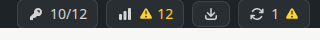
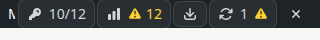
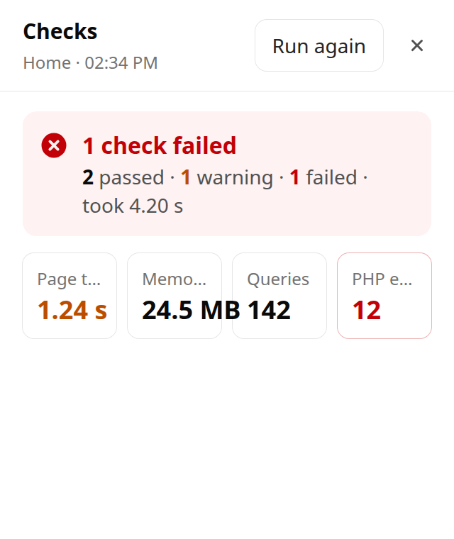
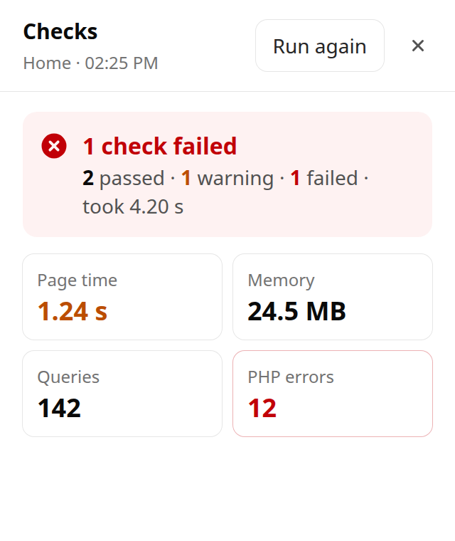

# Playground 0.11.1: the note heading after every update failed, Checks numbers at large text, a still spinner, Close at 320 px

- Date: 2026-11-21
- Owner: fleet builder (Claude Opus 5.5)
- Status: complete
- Disposition: kept
- Related version: 0.11.1
- Related commit/issue: TOOLS-396 and TOOLS-392; supersedes the 320 px follow-up in [Theme updates check PHP and WordPress versions; a failed or blocked update keeps its icon](2026-11-21-theme-version-check-and-failed-updates-icon.md)

## Context

Four small defects were left after 0.11.0:

- When the update step ran and every update failed, the Updates note heading still said **Updated at start** (`src/UpdatesControl.jsx`), while the button and its tooltip already said the update failed.
- In the Checks panel, the four numbers sat in four columns until the window was narrower than 399 px. At 640 px with the browser text at 200%, `24.5 MB` ran 27.5 px out of its tile into the next one.
- With reduce motion on, the updates and checks spinner kept turning, only slower (`spin 2.4s`).
- TOOLS-392: on a full bar at 320 px (`· 10 of 12 active`, `12 warnings`, an update result), Close's right edge was at 341.3 to 355.3 px, so up to about 35 px of it was off screen. The previous record left this as Lex chose on 2026-11-21; TOOLS-392 asks for Close to be fully visible and tappable.

## Hypothesis and success criteria

- The note heading says **Updates failed at start** when the step ran and every update failed; every other state keeps its heading.
- At 640 px with 200% text, no Checks number leaves its tile; with normal text from 400 px up, the four numbers stay in one row.
- With reduce motion on, the spinner does not animate; without it, it still turns.
- At 320 and 340 px, on a normal and a full bar in every update state, Close is fully inside the bar, the bar stays on one line, a tap at Close's centre reaches Close, and the page does not scroll sideways. Nothing changes from 360 px up.

## Options considered

- **Leave unchanged.** Each defect is visible to a user and small to fix.
- **Close at 320 px: hide another button's label or move Close into a menu.** The labels are already icon-only up to 767 px; hiding a button would remove a feature from phones. Tightening the gap and padding below 360 px fits Close with no feature removed.
- **Close at 320 px: a pixel `max-[360px]` breakpoint.** The bar's tests require each pixel breakpoint to come in a hide/show pair; a theme breakpoint (`xs`, 22.5rem, like `sm` and `md`) is the project's way to add a named width and scales with the text size.
- **Checks numbers: a smaller font or a lower pixel breakpoint.** A pixel breakpoint cannot see the text size; a container query in rem (`@max-[25rem]`) switches by the panel's width measured in the current text size, so larger text switches to two columns before a number spills.
- **Spinner: keep a slower turn.** A turning spinner is still motion; the label (`Updating…`, `running…`, `Running checks…`) already says the work is in progress.

## Implementation or prototype

- `src/lib/plugin-updates.js`: `updatesNoteHeading(updates)` returns **Updates at start** before the step finishes (also when networking is blocked or the step failed), **Updates failed at start** when it ran and every update failed, and **Updated at start** otherwise. `src/UpdatesControl.jsx` renders it in the note's heading.
- `src/UpdatesControl.jsx`: the shared `Spinner` uses `motion-reduce:animate-none`.
- `src/ChecksPanel.jsx`: the panel is a size container (`@container`) and the tiles use `@max-[25rem]:grid-cols-2` in place of `max-[399px]:grid-cols-2`. The panel is `min(25rem, 100%)` wide, so with normal text this switches below 400 px as before (399 px now has two columns, one pixel earlier).
- `src/styles.css`: a theme breakpoint `--breakpoint-xs: 22.5rem` (360 px).
- `src/App.jsx` and `src/UpdatesControl.jsx`: below `xs` the bar's gap is 4 px (`max-xs:gap-1`, 10 px above), the Licenses, Export snapshot, Close and shared bar button padding is 8 px a side (`max-xs:px-2`, 10 px above), and each phone tap area is the button plus that 4 px gap (`max-xs:w-[calc(100%+0.25rem)]`), so neighbouring tap areas meet without overlapping. Close is 32 × 28 px with a 36 × 56 px tap area at 320 px.
- `src/App.jsx`: the 0.11.1 changelog entry; `package.json` and `package-lock.json` at 0.11.1.

## Tests and evidence

| Environment | Procedure/command | Expected | Actual | Evidence |
| --- | --- | --- | --- | --- |
| Node 24, before the fix (9b98dcf, tests only on `dev` 4a346b2) | `node --test --test-reporter=spec src/lib/plugin-updates.test.js src/updates-control.test.js src/bar-compact-labels.test.js` | The five new tests fail | 23 tests: 18 passed, 5 failed (note heading helper, heading in the note, still spinner, bar below 360 px, Checks tiles by panel width) | The three test files |
| Node 24, after the fix (2bc9adb) | The same command; then `npm test`; then `scripts/agents/kit unit --affected` | All pass | 23 passed, 0 failed; `npm test` 285 passed, 0 failed; `RESULT: ok unit 29/29 (4 files)` | Same files |
| Headless Chrome (playwright-core with Chrome), `dev` 4a346b2 → this branch | A throwaway script renders a copy of the App bar with the real `UpdatesControl` and `ChecksButton`, the Updates note, the Checks panel and the spinner to static markup with each build's CSS, and measures them in the page: five update states (networking blocked, step failed, one update and two failures, every update failed, a long name) on a normal and a full bar at 320, 340, 360, 390, 640, 641, 767, 768, 1040, 1041 and 1280 px | Close inside the bar at 320 and 340 px; no change from 360 px up | Full bar at 320 px, Close's right edge: networking blocked and step failed 341.3 → 312.0, one update and two failures and every update failed 355.3 → 312.0, long name 335.3 → 312.0 (the bar's inner edge is 312); the page width 346/360/340 → 320. At 340 px the same cases 341.3/355.3/335.3 → 332.0. All 110 renders are one line, a tap at Close's centre reaches Close, and no two buttons overlap. From 360 px up every measurement is identical before and after (at 360 px a full bar puts Close's edge at 355.3, inside the screen, as before) |   |
| Same script | The Checks panel after a run at 640 px with `html { font-size: 200% }`, and at 1280 px 200%, 640/400/399/320 px 100%, 320 px 200%; columns counted and each number's overflow past its tile measured | No number outside its tile; four columns at 400 px and up with normal text | 640 px 200%: 4 columns with `24.5 MB` 27.5 px outside → 2 columns, 0 px outside. 1280 px 200%, 640 and 400 px 100%: 4 columns, 0 outside. 399 px 100%: 4 → 2 columns. 320 px: 2 columns |   |
| Same script, Chrome with reduced motion emulated | The bar's Updates spinner and the panel's `Running checks…` spinner; computed `animation` | No animation with reduce motion; turning without | Reduce: `spin 2.4s` → `none`. No preference: `spin 1s` before and after |  |
| Same script | The Updates note heading for each of the five states | Every update failed says it failed; the others unchanged | Every update failed: `Updated at start` → `Updates failed at start`. Networking blocked and step failed: `Updates at start`; one update and two failures, long name: `Updated at start` (unchanged) |  |

## Result

All four defects are fixed with the smallest change each, and the measurements show nothing moved outside the targeted widths and states.

## Disposition and rationale

Kept. Each change reuses an existing pattern (the note's state helpers in `plugin-updates.js`, Tailwind's `motion-reduce`, a theme breakpoint like `sm` and `md`, a container query in rem) and is covered by a test that failed before it.

## Documentation impact

- [rebuild-spec.md](../rebuild-spec.md): the bar below 360 px, the still spinner, the note heading when every update failed, the Checks tiles by panel width.
- [testing.md](../testing.md): the `plugin-updates.test.js`, `updates-control.test.js` and `bar-compact-labels.test.js` rows.
- [CONTEXT.md](../../CONTEXT.md): version 0.11.1.
- Changelog entry 0.11.1 in `src/App.jsx`; `package.json` and `package-lock.json` at 0.11.1.

## Follow-ups and open questions

- None. The 320 px follow-up of the previous record is closed by this change.
