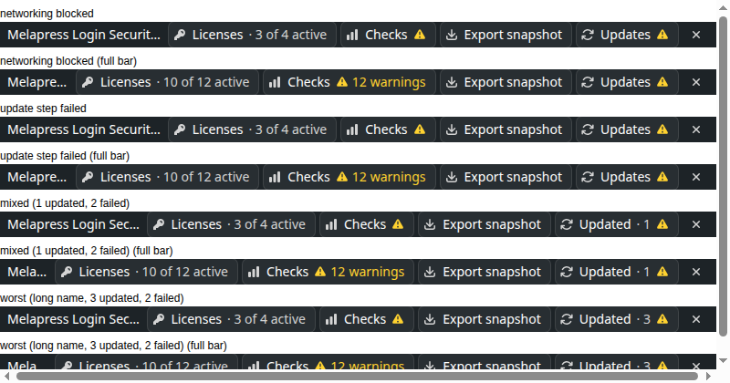

# Theme updates check PHP and WordPress versions; a failed or blocked update keeps its icon

- Date: 2026-11-21
- Owner: fleet builder (Claude Opus 5.5)
- Status: complete
- Disposition: kept
- Related version: 0.11.0 (not yet released; fixes before the release)
- Related commit/issue: TOOLS-259; supersedes in part [Release second look: Close on a narrow bar, network plugins, touch targets, a focusable note](2026-11-21-release-second-look-fixes.md)

## Context

The GPT second look and the Claude review on the 0.11.0 release (`dev` to `main`, PR #53) found two problems:

- P1, the update code: a plugin offer whose `requires_php` or `requires` this site does not meet was skipped, but a theme offer was not. A theme offer needing PHP 99 and WordPress 99 was passed to the theme upgrader and reported as updated. WordPress's single-theme upgrader does no such check of its own.
- P2, the bar: since the previous record, the words after Updates (`networking blocked`, `failed`) are screen-reader only up to 1040 px. When the update step failed or networking is blocked, the button then looked like a plain idle `Updates` button on every window up to 1040 px, and its tooltip said `Updated at start` in both states. The Checks waiting note and `N failed` keep an amber warning icon at every width; these two states had none.

## Hypothesis and success criteria

- A theme offer this site's PHP or WordPress cannot run is never passed to the upgrader; it is listed under failures with `Needs PHP <version> or newer.` or `Needs WordPress <version> or newer.`, like a plugin.
- When the update step failed or networking is blocked, the Updates button shows an amber warning icon at every width, its accessible name still says `failed` or `networking blocked`, and its tooltip names the state. Close stays inside the bar from 641 to 1280 px.

## Options considered

- **Leave unchanged.** An incompatible theme would be installed and could break the site; a failed update looks like nothing happened.
- **Show the words again from 768 px.** Undoes the previous record's fix: on a full bar Close was pushed off up to about 830 px.
- **A separate quiet mark for networking blocked.** Both states mean the plugins were not updated and match the Checks waiting note, which uses the amber icon for a step that did not run; the tooltip and the note tell them apart.

## Implementation or prototype

- `src/lib/plugin-updates.js`: one PHP helper, `techies_playground_incompatible()`, reads `requires_php` and `requires` from an offer (an object for plugins, an array for themes) and returns the reason or an empty string. The plugin loop uses it in place of its own two checks, and the theme loop now calls it before the upgrader.
- `src/UpdatesControl.jsx`: when the state is `error` or `skipped`, an amber `ExclamationTriangleIcon` (hidden from screen readers) follows the label at every width, right after `Updates` like the Checks waiting note. The tooltip says `Updates failed at start` in those states and also when the step ran but only failures came back (`Update failed`), or `Updates · networking blocked`. This replaces the previous record's rule that these two states show only `Updates` up to 1040 px; the words themselves stay screen-reader only up to 1040 px.

## Tests and evidence

| Environment | Procedure/command | Expected | Actual | Evidence |
| --- | --- | --- | --- | --- |
| Node 24, before the fix | `node --test src/lib/plugin-updates-php.test.js src/updates-control.test.js` with the new tests only | The two new tests fail | 2 failed: both themes reported as updated; no icon or state tooltip in the button | `plugin-updates-php.test.js` (theme versions), `updates-control.test.js` (warning icon) |
| Node 24, after the fix | `node --test src/updates-control.test.js src/bar-compact-labels.test.js src/lib/plugin-updates.test.js src/lib/plugin-updates-php.test.js` | All pass | 24 passed, including a theme offer this site can run still reaching the theme upgrader | Same files |
| Headless Chrome, this branch | The bar (real `UpdatesControl` and `ChecksButton`, a copy of the App bar), rendered to static markup with this branch's built CSS by a throwaway script, and measured in the page (Close's right edge against the bar, the button height, the icon's width): networking blocked, update step failed, one update and two failures, a long name with date versions; each with the normal bar and a full bar (`· 10 of 12 active`, `12 warnings`), at 641, 700, 767, 768, 800, 900, 1040, 1041, 1100 and 1280 px | Close inside the bar, one line, the amber icon visible | All 80 renders: Close inside the bar, one line, the amber icon visible |  |
| Playwright viewport emulation, this branch and `dev` (760ad32) | The same bar at 320, 360, 375, 390 and 414 px | No new phone regression from the icon | 360 to 414 px: Close inside on both. 320 px: Close is cut on a full bar and in the done-with-failures cases on both `dev` and this branch, so it comes from before this change | Measurements of both runs |

## Result

Both findings are fixed with the smallest change each. The theme upgrader is no longer called for an offer the site cannot run, and a failed or blocked update is visible on the button at every width without pushing Close off the bar.

## Disposition and rationale

Kept. Each change reuses an existing pattern (the plugin version check; the amber icon of the Checks waiting note and `N failed`) and is covered by a test that failed before it.

## Documentation impact

- [rebuild-spec.md](../rebuild-spec.md): step 11b skips plugin and theme offers alike; the Updates button's amber icon and state tooltip.
- [testing.md](../testing.md): the update code and Updates note rows.
- No changelog or version change: 0.11.0 is not yet released and its entry already says setups with networking turned off say so on the button.

## Follow-ups and open questions

- The 320 px phone case with a failed update stays as Lex chose on 2026-11-21.
