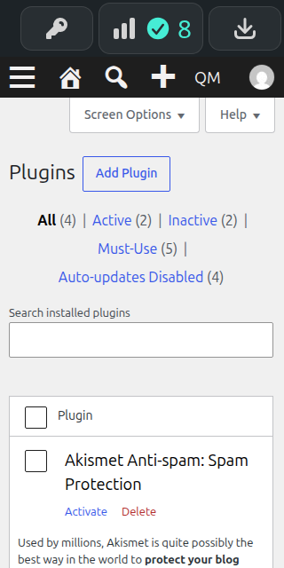
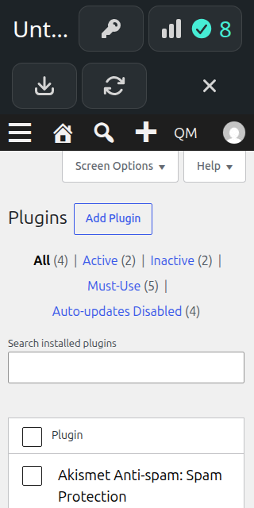
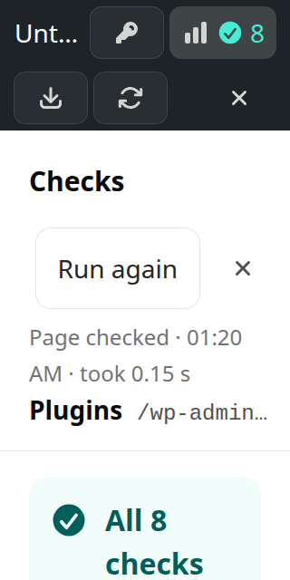
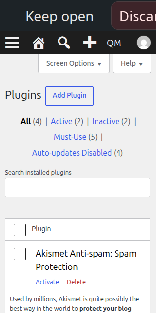
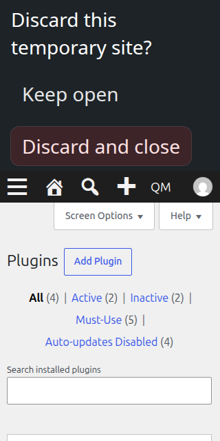
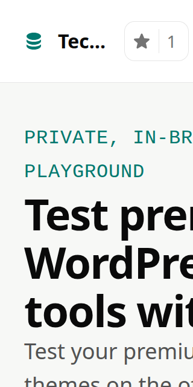
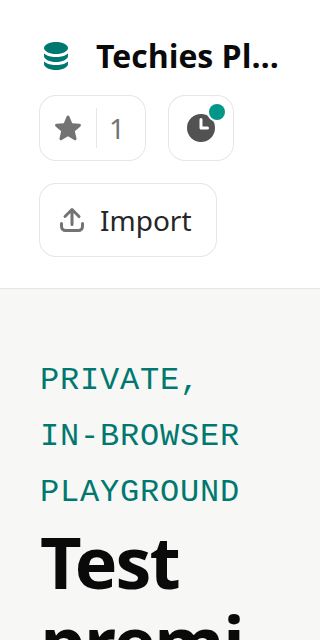

# Playground 0.12.2: big text on small phones (TOOLS-398)

- Date: 2026-11-22
- Owner: fleet builder (Gemini 4 Neon)
- Status: complete
- Disposition: kept
- Related version: 0.12.2
- Related commit/issue: TOOLS-398 (follows TOOLS-396 / PR #61 and TOOLS-388)

## Context

On a 320 px phone with 200% text (`html { font-size: 200% }`), three of the four TOOLS-398 checks were still broken on `dev` (8c7d807):

- **Close Playground off screen:** the Playground shell locked its bar row to `2rem` with no wrap, so at 320 px with 200% text (`1rem = 32px`, shell width `10rem`) the five bar buttons totaled 496 px and pushed Updates (`324..404`) and Close (`412..492`) off the 320 px screen.
- **Close confirmation overflow:** pressing Close on a temporary site squeezed `"Discard this temporary site?"` to `0 px`, rendered `Keep open` at `36..208.7` and pushed `Discard and close` to `228.7..490.8` (cut off at `"Discar"`, untappable).
- **Sideways scroll at 320 px with 200% text:** `body { min-width: 20rem }` forced the document to 640 px wide on a 320 px screen. Even without that rule, unwrapping rows and intrinsic-width inputs (`AppHeader` controls, Environment header, `Advanced settings` `<fieldset>`/`Select`/`TextField`, 2-column Featured plugins grid, Checks section badges/buttons, `recipe-name`, `h1`, `Checkbox`/`Radio` labels, `LaunchSummary` rows) caused sideways scroll up to 644 px.
- **Checks panel title:** already wrapped cleanly above **Run again** and **Close Checks** in TOOLS-388 (verified for both overview `Checks` and detail `All checks`).

## Hypothesis and success criteria

1. At 320 px with 200% text, **Close Playground** (and **Close Checks**) is fully on screen, tappable, with at least 44 px tap areas and no overlapping tap areas.
2. At 320 px with 200% text, the Checks title (`Checks` and `All checks`) is not hidden behind **Run again**.
3. At 320 px with 200% text (and 100% text), **Keep open** and **Discard and close** have at least 44 px tap areas, do not overflow 320 px, and do not overlap each other.
4. No sideways scroll at a 320 px window (`scrollWidth === 320`) at both 100% and 200% text across all launcher tabs, open Advanced settings, and selected checks.
5. Normal text (100%) from 320 px up keeps the single-row 32 px Playground bar and existing desktop/tablet layout unchanged.

## Options considered

- **Unconditional `flex-wrap` on the Playground bar.** Rejected: flexbox wraps before shrinking, which would break the `Updates` button's shrink-to-fit name truncation from 1041 px up.
- **Viewport `@media (width < 20rem)` query.** Rejected: media-query `rem` tracks the browser default font size rather than `html { font-size: 200% }`.
- **Container query `@max-[20rem]` on the Playground shell (chosen).** Below `20rem` of shell width (never matched at 100% text for widths >= 320 px; matched at 320 px from 125% to 200% text and up to 639 px at 200%), the bar row expands (`grid-rows-[minmax(2rem,auto)_1fr]`) and wraps cleanly, keeping 100% text identical.
- **Remove `body { min-width: 20rem }` and constrain intrinsic grid/flex children (chosen).** Uses existing Tailwind theme tokens (`@container`, `@[15rem]:grid-cols-2`, `grid-cols-1`, `min-w-0`, `flex-wrap`, `[overflow-wrap:anywhere]`) without shrinking text below 200%.

## Implementation or prototype

- `src/App.jsx`:
  - Playground shell grid adds `@container` and changes `grid-rows-[2rem_1fr]` to `grid-rows-[minmax(2rem,auto)_1fr]`.
  - Playground bar row adds `@max-[20rem]:flex-wrap @max-[20rem]:py-1`, plus `@max-[20rem]:gap-x-1 @max-[20rem]:gap-y-2` on the normal bar only (keeping the close confirmation's `max-sm:gap-2.5` gap).
  - Bar buttons add `@max-[20rem]:min-h-7` (`UpdatesControl.jsx` `BAR_BUTTON_CLASS`, Licenses, Export snapshot) so icon-only buttons match the 28 px base height when wrapped, and `Close Playground` adds `@max-[20rem]:ml-auto`.
  - Bar tap targets (`BarTapTarget` in `src/UpdatesControl.jsx` and the three inline spans in `src/App.jsx`) add `@max-[20rem]:h-[calc(100%+0.5rem)] @max-[20rem]:w-[calc(100%+0.25rem)]` so wrapped rows meet at the midpoint without overlapping vertically and stay >= 44 px from 125% to 200% text.
  - Close confirmation prompt adds `@max-[20rem]:basis-full @max-[20rem]:whitespace-normal`; **Keep open** and **Discard and close** add `max-w-full` and cap their `@max-[20rem]` tap-span minimum to `44px` (`@max-[20rem]:h-[max(100%,44px)] @max-[20rem]:w-[max(100%,44px)]`) so 56 px tall buttons at 200% text do not grow to 88 px overlays that overlap across rows.
  - Launcher layout: `AppHeader`, Environment header and `LaunchSummary` rows allow wrapping; `Select`, `TextField`, `Advanced settings` `<fieldset>`s, `Uploaded themes` and `Name and save` use `grid-cols-1` / `min-w-0` / `w-full`; Featured plugins grid switches to 1 column below `15rem` (`@container` + `grid-cols-1 @[15rem]:grid-cols-2 lg:grid-cols-4`); Checks cards allow wrapping without `shrink-0` overflow; `h1`, `Checkbox`, `Radio` and empty theme-upload button use `[overflow-wrap:anywhere]`.
- `src/styles.css`: removed `min-width: 20rem` from `body`.
- `src/bar-compact-labels.test.js` & `src/checks-panel.test.js`: three new regression tests covering the `< 20rem` bar wrap, close confirmation wrap/tap bounds, and launcher 320 px 200% rules.
- Version and changelog: bumped `0.12.1` → `0.12.2` in `package.json`, `package-lock.json`, `CONTEXT.md` and `CHANGELOG_ENTRIES`.

## Tests and evidence

Real-browser measurements ran in headless Google Chrome (via `playwright-core`) against a local production build (`VITE_PLAYGROUND_ORIGIN=https://preview-wp.techies.tools npx vite build`, served on `http://127.0.0.1:4173` via `vite preview`) with touch enabled (`hasTouch: true`), a temporary WordPress 7.1.5 / PHP 8.3 site with Query Monitor and Code Profiler from WordPress.org, networking on, and `html { font-size: 200% }`. Console saw only the expected `favicon.ico` 404 from `vite preview` and zero page errors.

| Environment | Procedure/command | Expected | Actual | Evidence |
| --- | --- | --- | --- | --- |
| Node 24, before fix | `node --test --test-reporter=spec src/bar-compact-labels.test.js` with the 3 new tests | 3 new tests fail | 9 tests: 6 passed, 3 failed | `src/bar-compact-labels.test.js` |
| Node 24, after fix | `scripts/agents/kit unit --affected` and `npm test` and `scripts/agents/kit build` | All pass | `RESULT: ok unit 28/28 (2 files)`; `npm test` 324/324 pass; `kit build` passes | Test suite + Vite build |
| Chrome 320 px, 200% text, real Playground (before → after) | Launch temporary site with Query Monitor & Code Profiler, measure top bar buttons and `elementFromPoint` | Close fully on screen (`right <= 320`), tappable (`hitSelf: true`), tap >= 44 px, no tap overlaps | Before: `barScrollW: 496`, Updates `324..404` (`onScreen: false`), Close `412..492` (`onScreen: false`, `hitSelf: false`). After: `barScrollW: 320`, `barH: 144`, all 5 buttons `onScreen: true` & `hitSelf: true`, Close `224..304` (tap `88 × 72`), `overlaps: []` |   |
| Chrome 320 px, 200% text, real Playground (after) | Open Checks panel overview and one check detail (`PHP errors`), measure title vs Run again vs Close Checks | Title above Run again, panel `scrollWidth === 320` | Overview `Checks` `32..137.5, y=164..236`, `Run again` below at `39.5..220, y=252..340`, `Close Checks` `236..300`. Detail `All checks` `16..232.6, y=164..252`, `Run again` below at `y=268..356`. `panelScrollW === 320` |  |
| Chrome 320 px, 200% text, real Playground (before → after) | Tap Close Playground on temporary site, measure prompt, Keep open, Discard and close and tap overlap | Both buttons on screen, tappable, >= 44 px tap area, no overflow, no overlap | Before: `barScrollW: 491`, prompt `w: 0`, Keep open `36..208.7`, Discard and close `228.7..490.8` (`onScreen: false`, cut off at "Discar"). After: `barScrollW: 320`, prompt `16..304` (`w: 288`), Keep open `16..188.7` (tap `172.7 × 56`), Discard and close `16..278.1` (tap `262.1 × 56`), both `onScreen: true` & `hitSelf: true`, `tapOverlap: false` |   |
| Chrome 320 px, 100% & 200% text, launcher (before → after) | Measure `documentElement.scrollWidth` on start page, open Advanced settings, all 4 tabs, and with Query Monitor + Code Profiler selected | `scrollWidth === 320` in every state | Before: 100% `320`, 200% `640` (`body` 640, 622 without `body` min-width, 644 with Advanced open). After: `320` at 100%, `320` at 200%, `320` with Advanced open, `320` across all 4 tabs (`Saved recipes`, `Choose plugins`, `Choose themes`, `Past spin-ups`), `320` with Query Monitor + Code Profiler selected |   |
| Chrome full-bar & confirmation matrix (after) | Built CSS tested with full bar (`10/12`, `12` warnings, `12` + `2` failed) and close confirmation across 320 px (100–200%), 360/384 px (100%), 400/480 px (200%) | All on screen, `scrollWidth <= vw`, tap >= 44 px, zero tap overlaps | Full bar passes 320 px at 100/125/150/175/200% (`barH` 32 at 100%, 90–216 wrapped; `minTapW` 44–88, `minTapH` 45–72, `overlaps: []`), 360/384 px at 100% (`barH: 32`), and 400/480 px at 200%. Close confirmation passes all 14 widths/scales (320–1280 px, 100–200%) with zero overlaps | Matrix run against built CSS |

## Result

All four TOOLS-398 acceptance criteria pass at 320 px with 200% text (and 100% text), verified on the real embedded WordPress 7.1.5 Playground and across all launcher tabs and open Advanced settings. Normal 100% text layouts from 320 px to 1280 px are unchanged.

## Disposition and rationale

Kept. Minimal Tailwind CSS/JSX changes reusing existing container-query and wrapping patterns, with failing-first regression tests and real-browser before/after measurements and screenshots.

## Documentation impact

- `docs/rebuild-spec.md`: Playground bar and close confirmation wrapping below 20 rem.
- `docs/testing.md`: updated test count and `bar-compact-labels.test.js` coverage description.
- `CONTEXT.md`, `package.json`, `package-lock.json`, `src/App.jsx` (`CHANGELOG_ENTRIES`): version `0.12.2`.
- `docs/changes/README.md`: indexed this record.

## Follow-ups and open questions

- At exactly 640 px with 200% text (`20rem` shell width, outside the 320 px scope of this card), a full bar with two-digit counts exceeds 640 px because `max-xs:` is a viewport media query (`384px`) while `@max-[20rem]` activates strictly below `20rem`.
