# Design report review fixes (TOOLS-457)

- Date: 2026-11-24
- Owner: fleet-lead
- Status: complete
- Disposition: kept
- Related version: 0.13.8
- Related commit/issue: TOOLS-457; follow-up to [PR #75](https://github.com/techiesreviews/techies-playground/pull/75)

## Context

The [TOOLS-450 results page](2026-11-24-design-report-look.md) landed with three
open P2 findings. Loose AI-note matching described visible margin/viewport defects
as "Not visible". A 98.96% match displayed as 99%, although its state remained
partial. The picture viewer clipped half the 44 px slider handle and its focus ring
at 0% and 100%. This record supersedes those three behaviors; the approved layout
and the earlier record's other results remain applicable.

## Hypothesis and success criteria

Keep visible layout misses visible, keep every score below 99% below that displayed
threshold, and expose the complete handle and ring at both ends, at 1440/390 in
light/dark. Preserve the approved TOOLS-450 look elsewhere.

## Options considered

- Leave unchanged: rejected because each reported defect is reproducible.
- Guess invisible behavior from keywords: rejected; a theme restriction can have
  visible consequences. Only an exact article-semantics note is labelled invisible.
- Add precision only near 99%: valid, but flooring to one decimal everywhere gives
  one consistent formatter for the hero, size rows and interactive footer.
- Move the handle inward: would move it away from the comparison boundary. Instead,
  round the pictures themselves and let the handle extend into the existing gutter.

## Implementation or prototype

`scripts/design-report.mjs` classifies margin, box-sizing and viewport-metadata notes
as visible; mixed notes retain their wording. Metadata notes with uncertain effects
retain neutral AI-note wording. Scores use one shared floored formatter, including
the embedded script. `scripts/design-report.css` rounds the images instead of
clipping the viewer and its interactive descendants. No new controls or motion.

The existing browser diagnostic now saves Home/End screenshots and checks the
entire hit area, focus state, clipping ancestors and viewport bounds.

## Tests and evidence

| Environment | Procedure/command | Expected | Actual | Evidence |
| --- | --- | --- | --- | --- |
| Node 24.22.2 | `kit doctor`, then locked `npm ci --ignore-scripts`, `kit deps check`, `kit doctor` | Resolve missing dependencies | First doctor failed on missing `@heroicons/react`; installed locked dependencies; deps matched 241 packages, doctor 17/17 | [Validation](2026-11-24-design-report-review-fixes/validation.txt) |
| Node | `kit unit scripts/design-runner.test.mjs`, before SL-1 fix | Visible margin note fails | 17/18; `false !== true` for shifted body margin | [Validation](2026-11-24-design-report-review-fixes/validation.txt) |
| Node | Same, before narrowing semantic matching | Mixed semantic/layout note fails | 17/18; mixed article/body-margin note incorrectly invisible | [Validation](2026-11-24-design-report-review-fixes/validation.txt) |
| Node | Same, after SL-1 fix | All five visible-note cases pass | 18/18 | [Validation](2026-11-24-design-report-review-fixes/validation.txt) |
| Node | Same, before SL-2 fix | 98.96% fails honest display | 18/19; `'99' !== '98.9'` | [Validation](2026-11-24-design-report-review-fixes/validation.txt) |
| Node | `kit unit --affected`, after SL-2 fix | 98.96/98.99/99/100 display boundaries pass in hero, rows, footer | 19/19 | [Validation](2026-11-24-design-report-review-fixes/validation.txt) |
| Chromium | `kit go tools-457-ends-before -- node scripts/design-report-check.mjs .scratch/tools-457/ends-before` | Catch clipped endpoints | Failed: `clippedBy: ["viewer"]`, `grabbable: false`; all eight before screenshots saved | [Before geometry](2026-11-24-design-report-review-fixes/before-slider-ends.json) |
| Chromium | Same browser command with `tools-457-ends-after` and `.scratch/tools-457/ends-after` | Complete handle/ring at both ends | Passed all eight focused endpoints and 12 layouts; 44×44 hit areas, no clipping/overflow/page errors/HTTP requests; existing keyboard, mouse, touch, offline and enlarged-text checks passed | [After evidence](2026-11-24-design-report-review-fixes/after-browser-evidence.json) |
| Node | `kit unit` | Whole suite passes | 425/425, 43 files | [Validation](2026-11-24-design-report-review-fixes/validation.txt) |
| Vite | `kit go tools-457-build -- scripts/agents/kit build` | Build passes | Passed; existing browser-externalization and large-chunk warnings | [Validation](2026-11-24-design-report-review-fixes/validation.txt) |
| Kit UX | `kit go tools-457-ux -- scripts/agents/kit ux` | Report missing integration | Failed ENOENT: no `docs/agents/features.md`; no feature list invented. `kit shots` is also unavailable. No kit UX verdict claimed. | [Validation](2026-11-24-design-report-review-fixes/validation.txt) |

T3 `preview_open` rejected the local prototype with `unsupported-protocol: file:`.
The repository's Playwright diagnostic supplied the browser evidence above. Two
initial screenshot attempts failed because viewport-only screenshot bounds excluded
the scrolled document region; full-page clipping corrected the evidence helper
before the recorded slider regression run. No browser profile or configuration was changed.

## Result

Done when 1: met — the visible-layout regression failed first on body margin and on a mixed article/body-margin note; all five cases now stay visible, produce partial state and never render "Not visible".

Done when 2: met — the cutoff regression failed first with `'99' !== '98.9'`; 98.96% and 98.99% now display 98.9% in the hero, both size rows and comparison footer; 99% and 100% remain exact.

Done when 3: met — Home/End failed first with the viewer clipping the focus ring and half the grab area; all eight 1440/390 light/dark endpoints now expose a full 44×44 target and focus ring, with no clipped ancestor or viewport overflow.

## Disposition and rationale

Kept. The changes fix the three reported defects while preserving the approved
layout and comparison boundary. Actual public fixture PNG differences are 70,464
pixels at 1440 (95.10666666666665% match) and 131,849 at 390 (66.1925641025641%).
The generated sample, HTML/JSON plus four PNGs, is saved at
`/home/ubulex/Projects/fleet/inbox/playground-TOOLS-457-sample-report/`.
Tester measurements and block inventory are injected public fixtures, not a new AI,
WordPress, or tester pipeline execution. No private Melapress result was read.

## Documentation impact

Updated the run guide, rebuild specification, architecture inventory, data contracts,
testing guide, context version, changelog and package/lockfile versions.

## Follow-ups and open questions

- Lead: close TOOLS-457 (Done, with a dated note naming the PR and its merge SHA).
- Lex compares the sample report with the approved prototype after landing.

## Slider endpoint screenshots

Each pair shows the same saved report position before and after the CSS fix.

### 1440 px, light, Home

Before:

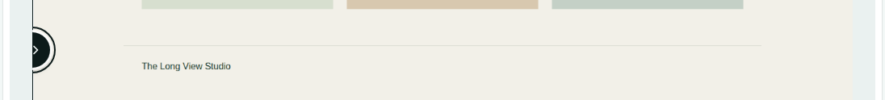

After:

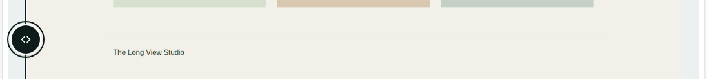

### 1440 px, light, End

Before:

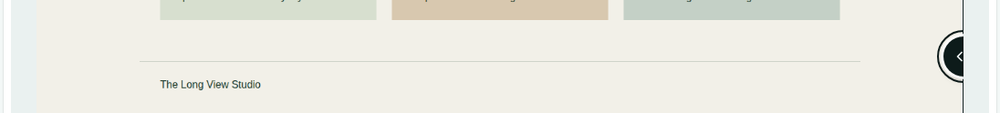

After:

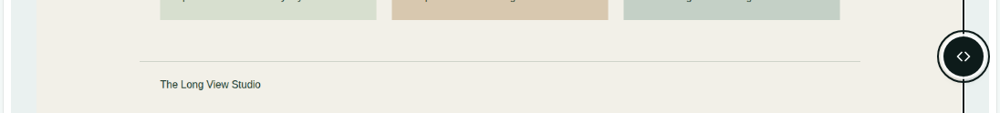

### 1440 px, dark, Home

Before:

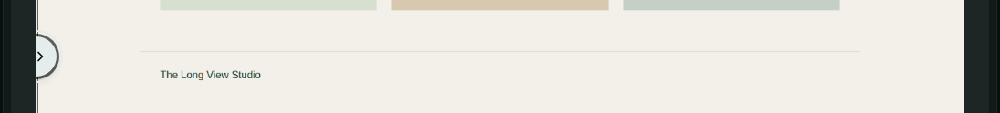

After:

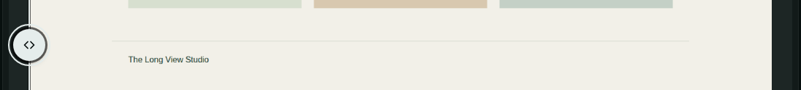

### 1440 px, dark, End

Before:

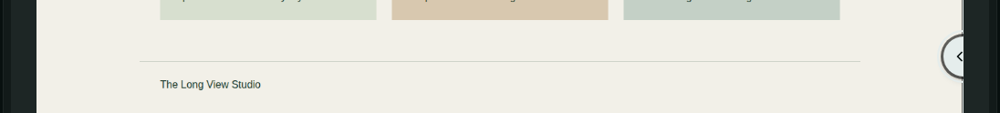

After:

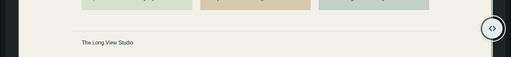

### 390 px, light, Home

Before:

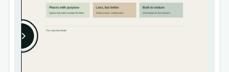

After:

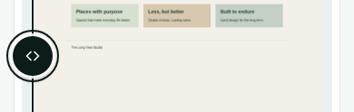

### 390 px, light, End

Before:

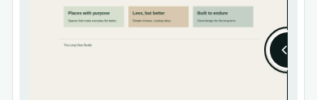

After:

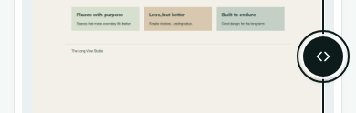

### 390 px, dark, Home

Before:

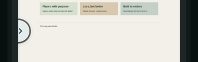

After:

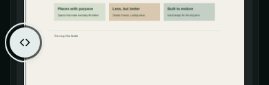

### 390 px, dark, End

Before:

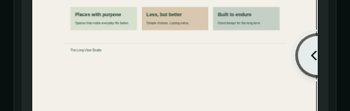

After:

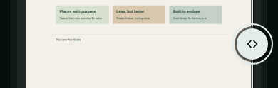
